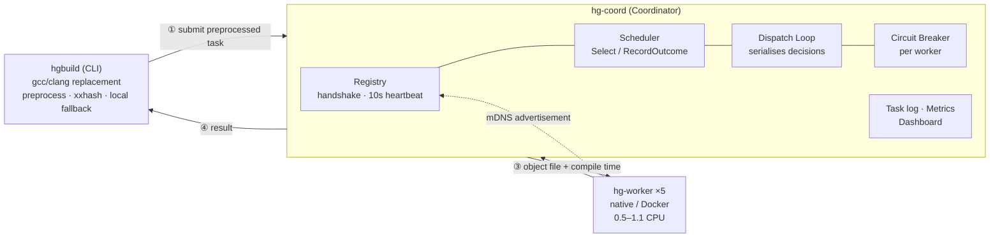
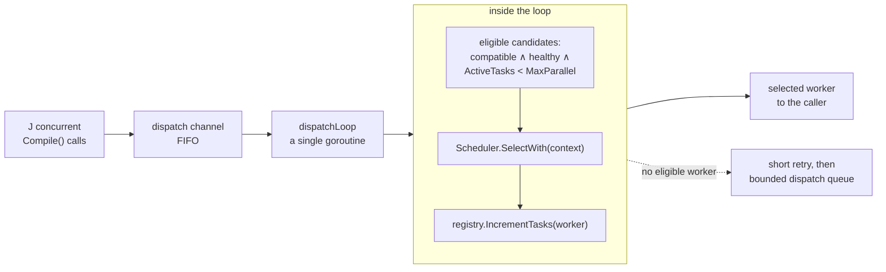

# Hybrid-Grid: Distributed Compilation with Adaptive Scheduling under Unadvertised Worker Slowdown

**Le Duc Hieuᵃ˒\*, Nguyen Trung Kienᵃ, Nguyen Trong Khanhᵃ**

ᵃ *Posts and Telecommunications Institute of Technology, Hanoi, Vietnam*

\* *Corresponding author:* leduchieu101@gmail.com

---

## Abstract

This paper presents Hybrid-Grid, an open-source distributed compilation system for C/C++, and **HG-LinUCB-D**, the learning scheduler at its centre. Building the system taught us that the hard part of distributed compilation is deciding which worker each translation unit should go to — and that this decision gets hard when a worker's advertised capacity stops describing how fast it actually runs, as happens when a workstation's owner starts a render or a build of their own. HG-LinUCB-D extends our contextual-bandit scheduler with **per-worker exponential forgetting**, so that each worker's model is dominated by its recent compile outcomes. We evaluate it on abseil-cpp over five heterogeneous Docker workers at three concurrent jobs, with two workers silently losing CPU to background contention. With the implementation frozen before measurement, HG-LinUCB-D with discount factor γ = 0.80 reduces second-build time by 21.7% against LeastLoaded, 29.9% against SED and 9.0% against γ = 0.98 over 15 blocks, and by 30.7%, 30.3% and 11.0% over 10 blocks of a partially held-out scenario, faster than all three in every block (Holm-adjusted p ≤ 0.0078). Dispatch traces show reduced exposure to degraded workers: under HG-LinUCB-D they received a median 2.6–3.3% of build-2 tasks, versus 24–26% under LeastLoaded and 34–39% under SED. The scenario was identified through exploratory experiments, and our conclusions are limited to it.

**Keywords:** distributed compilation; task scheduling; contextual bandit; non-stationary bandit; heterogeneous cluster; performance interference

---

## 1. Introduction

Distributed compilation is an everyday reality of modern software engineering. Large C/C++ projects such as LLVM, Chromium and the Linux kernel contain tens of thousands of translation units; a clean single-machine build can take hours. Systems such as distcc [15], Bazel Remote Build Execution and Incredibuild address this by offloading compilation tasks to a pool of remote workers. That pool is inherently *heterogeneous* — developer workstations, Linux CI servers, cloud nodes, dedicated build machines — and, in the setting this paper cares about, it is also *shared*: the workstations that lend their cores to the build belong to people who keep working on them.

While building Hybrid-Grid, the distributed compilation system presented in this paper, we found that the components usually considered hard — shipping preprocessed source, content-addressed caching, worker discovery, fault isolation — all have well-understood engineering solutions and, once implemented, work reliably. The component that is genuinely hard is the **scheduler**: the function that decides which worker each translation unit goes to. Assigning tasks to heterogeneous machines is the NP-hard $R||C_{\max}$ problem [1], it must be solved online as tasks arrive [2], and compile times are heavy-tailed — on our clusters the P99/P50 ratio reaches 26×.

Our first answer to that problem was **HG-LinUCB**, a contextual-bandit scheduler that learns from compile outcomes on the running system, with no simulator and no offline training. Under a blocked, paired protocol it clearly beat plain LinUCB and Power-of-Two-Choices, but it did **not** establish an advantage over LeastLoaded, the heuristic that picks the worker with the fewest running tasks. Reconstructing cluster state at every dispatch showed a consistent picture: at `-j5` on that stable cluster, every dispatch had an idle worker available, LeastLoaded and HG-LinUCB almost always selected one, and the two finished builds in similar times.

That result sharpened the question rather than closing it. **An idle worker need not be an effective worker.** LeastLoaded and capacity-weighted rules decide from how many tasks a worker is running and how much capacity it advertises. When a colleague starts a video render on the workstation behind worker 4, its advertised cores and slot limit stay the same; LeastLoaded and SED can react only indirectly, as slower compiles keep its slots occupied for longer, and they cannot tell two idle workers apart by how fast they have been compiling. Compile times are exactly what a learning scheduler observes.

How quickly a learner acts on them depends on how long it remembers. Retaining every past outcome gives early observations lasting influence, so a worker that was fast for most of a session keeps looking fast for a while after it slows down. **HG-LinUCB-D** keeps everything that made HG-LinUCB work — the per-worker context models, the passive warm start, the instantaneous load penalty — and adds per-worker exponential forgetting. With a discount factor of γ = 0.80, a worker's three most recent outcomes account for about half of its model's total observation weight.

This paper evaluates that design in the scenario that motivated it: a cluster that still has spare capacity, in which some workers silently slow down. The scenario was identified, and γ selected, through exploratory experiments; we then froze the implementation and analysis plan before collecting the data reported here. Across 15 blocks of the primary scenario and 10 blocks of a second scenario with different degraded workers and a different onset, HG-LinUCB-D finished the measured build faster than LeastLoaded, SED and its own long-memory variant in every block, by 21.7–30.7% against the two heuristics.

The specific contributions are:

- **C1. Hybrid-Grid** (Section 3): an integrated distributed compilation system in Go — compiler interception, worker eligibility, a serialised dispatch path, execution feedback and task-level observability — connected through one scheduling interface that hosts both heuristic and learning schedulers.
- **C2. HG-LinUCB-D** (Sections 5 and 7): a scheduler designed around delayed and changing feedback, combining disjoint contextual models, a passive-learning warm start, an instantaneous load penalty and per-worker exponential discounting. We specify the update as implemented, with its computational cost, and claim no new regret guarantee.
- **C3. Available versus effective capacity** (Sections 4 and 6): starting from our earlier stable-cluster results, we characterise one condition under which worker selection matters beyond picking an idle worker — a worker can have a free slot while offering poor execution speed — and state it as a scheduling problem.
- **C4. Frozen, blocked evidence** (Section 8): four reported schedulers, 15 blocks of a primary scenario and 10 blocks of a partially held-out one, Latin-square ordering, paired tests with Holm correction.
- **C5. Trace-level evidence for the mechanism** (Section 8.4): from logged per-candidate learned values, exploration bonuses and load penalties, we connect what the learner estimated about each worker to the allocation it produced.

Section 2 reviews related work. Section 3 describes Hybrid-Grid and Section 4 states the scheduling problem. Section 5 presents HG-LinUCB, Section 6 the stable-cluster results and the question they raised, and Section 7 HG-LinUCB-D. Section 8 evaluates it, Section 9 discusses findings and limits, and Section 10 concludes.

## 2. Related Work

### 2.1. Heuristic scheduling on heterogeneous machines

Lenstra, Shmoys and Tardos [1] proved $R||C_{\max}$ NP-hard with a $3/2$ approximation lower bound and gave a ratio-$2$ algorithm; the gap remains open after more than 35 years. In practice Power-of-Two-Choices [3] is the prominent heuristic: sampling two servers at random and choosing the less loaded one reduces maximum load from $\Theta(\log m / \log\log m)$ to $\Theta(\log\log m)$ on homogeneous clusters of $m$ servers. Sparrow [4] extends P2C with late binding for low-latency decentralised scheduling. HEFT [5] ranks DAG tasks by upward rank and assigns them by earliest finish time, using estimates of each task's cost on each machine. Shortest-expected-delay rules, of which the SED baseline in Section 8 is an instance, weight queue length by advertised capacity. Queue-length and capacity-weighted rules have no explicit estimate of a machine's current speed; when that speed departs from what the machine declares, they notice it only through the side effect that slower tasks stay in the queue longer.

### 2.2. Multi-armed and contextual bandits

The classical bandit framework is presented systematically in Sutton and Barto [6]; UCB1 [16] introduced optimism under uncertainty into arm selection, and Slivkins [7] and Lattimore–Szepesvári [8] systematise the regret theory. LinUCB [9] extends to the contextual setting: each arm $a$ keeps ridge-regression statistics $(A_a, b_a)$ over $d$-dimensional contexts $x$, with estimate $\hat\theta_a = A_a^{-1} b_a$, and is scored by $\hat{\theta}_a^\top x + \alpha\sqrt{x^\top A_a^{-1} x}$, where $\alpha$ weights exploration. A $\tilde{O}(\sqrt{Hd})$ regret bound over $H$ rounds is proven for the SupLinUCB variant [10]; that bound does not apply directly to the basic LinUCB algorithm (Algorithm 1 of [9]) that real systems, including ours, implement.

### 2.3. Bandits that forget, and latency-aware selection

When reward distributions change over time, a learner that weighs all history equally adapts slowly. Garivier and Moulines [23] analysed two remedies for the multi-armed case: discounting past rewards geometrically (D-UCB) and keeping only a sliding window (SW-UCB). For linear bandits, Russac, Vernade and Cappé [24] proposed D-LinUCB, a weighted least-squares estimator with exponentially decaying weights, a round-based clock and a confidence width derived for that weighting; Cheung, Simchi-Levi and Zhu [25] studied the sliding-window counterpart. HG-LinUCB-D borrows the exponential weighting but neither the clock nor the confidence analysis (Section 7), so none of these guarantees transfer to it.

A second line of work learns endpoint latency for load balancing in serving systems. Peak EWMA, used in Linkerd and Tower [26, 27], scores an endpoint by a decaying latency estimate multiplied by (pending requests + 1), and C3 [28] combines server-reported service times with queue feedback to rank replicas in a data store. These systems establish that combining observed latency with outstanding work is a sound idea. Our contribution is not the idea of learning a server's speed but its design, integration and evaluation for compilation dispatch, where tasks differ widely in size, feedback is delayed by the very compile time being learned, and the learner must coexist with a slot-based admission rule.

Straggler mitigation in data-parallel frameworks — LATE [29] and Mantri [30] — handles slow machines by speculatively re-executing or relocating tasks that are already running. HG-LinUCB-D acts earlier and more modestly: it changes where the *next* task goes and never duplicates work.

### 2.4. Machine learning for systems scheduling

Decima [12] uses a graph neural network with REINFORCE to schedule Spark jobs and DeepRM [11] applies policy gradients to resource management; both train over many episodes in a simulator before deployment. Quasar [13] uses collaborative filtering to predict job performance on each machine type, and Resource Central [14] predicts VM behaviour with offline models at production scale. The gap this work targets is *online, simulator-free learning applied to distributed compilation*, evaluated on a real running system.

### 2.5. Distributed build systems

Compiler caching and remote execution address different parts of the build path. ccache reuses compilation outputs, while distcc [15] distributes compiler work according to a configured host list and concurrency limits. Buildbarn [22] learns per-action size-class outcomes across builds, serving resource-class prediction rather than worker selection. Our evaluation concerns worker selection within Hybrid-Grid; it does not compare production build services or their scheduling policies.

## 3. The Hybrid-Grid System

### 3.1. Architecture

The system comprises three components communicating over gRPC on HTTP/2 (optional TLS/mTLS), laid out as in Figure 1:

- **`hgbuild` (CLI):** a drop-in gcc/clang replacement that also wraps `make`/`ninja`. It preprocesses source locally, hashes the preprocessed output with xxhash for cache lookup, submits the task to the coordinator, and can *fall back* to local compilation when the coordinator is unavailable — so an infrastructure failure slows a build down rather than breaking it.
- **`hg-coord` (Coordinator):** the central orchestrator, comprising the worker registry (gRPC handshake registration, 10-second heartbeats), the **scheduler** (the object of study, Sections 4–8), the serialised dispatch path (Section 3.3), per-worker circuit breakers, Prometheus metrics, OpenTelemetry tracing and a real-time dashboard.
- **`hg-worker` (Worker):** executes compilation natively or in Docker (cross-compilation via dockcross images), keeps a local content-addressed cache, and self-advertises via mDNS.



**Figure 1.** Hybrid-Grid architecture. `hgbuild` submits preprocessed tasks to `hg-coord`; the scheduler selects one of the eligible workers; the object file and its compile time flow back, serving both as the client's answer and as the reward signal for the learning scheduler.

Beyond the C/C++ path that is our focus, the system also supports distributed Flutter Android builds and GCC/Clang-to-MSVC flag translation; these paths do not go through the learning scheduler and are outside the evaluation's scope.

### 3.2. Lifecycle of a compilation task

A translation unit travels through seven steps. `hgbuild` intercepts the compiler call and preprocesses locally (①), hashes the preprocessed output with the compile flags into a cache key (②), and returns immediately on a cache hit (③). On a miss, the scheduler ranks the workers that are compatible, healthy and have a free slot (④) and chooses one, recording the context it chose on (⑤). The worker compiles and returns the object file with its compile time (⑥), and the coordinator feeds that outcome back to the scheduler (⑦) and writes a task-log record.

Two properties of this lifecycle shape Sections 5 and 7. First, the scheduler sees cluster state only *as of* step ⑤, while the reward for that decision returns only at step ⑦, a full compile time later — up to several seconds at the tail, during which many other decisions are taken. Second, a build is short for an online learner: the workload in Section 8 issues 152 compilation tasks per build.

### 3.3. The coordinator's dispatch path

With `make -jJ` or `ninja -jJ`, up to $J$ `Compile()` calls request a decision at once. The decision reads worker state (`ActiveTasks`) and the dispatch writes it back; if those were separate operations across goroutines, two dispatches could read the same stale count and overbook the same worker. Hybrid-Grid confines reading worker state, selecting a worker and recording the dispatch to **a single `dispatchLoop` goroutine** (Figure 2). Each `Compile()` call submits a request into a channel and waits; a Go channel already *is* a synchronised FIFO queue, so selection and booking are serialised against other dispatches without an additional lock around that pair of operations.



**Figure 2.** The serialised dispatch path. Reading worker state, selecting a worker and recording the dispatch sit inside one goroutine, so concurrent dispatches cannot book the same slot twice.

Every evaluated scheduler enforces worker compatibility, health and slot availability (`ActiveTasks < MaxParallel`) before ranking candidates, so none can select a full worker. Circuit-breaker handling is policy-specific: LeastLoaded does not inspect breakers, while the bandit and SED paths exclude open breakers but relax that exclusion when no candidate would otherwise remain. A concurrency regression test — 5 workers with `MaxParallel = 1`, 40 batches of 5 concurrent dispatch-and-release cycles, an independent atomic counter asserting that no worker ever exceeds capacity — passes cleanly over 20 repeated runs. After eight unsuccessful selection attempts, including 700 ms of backoff, a request enters a bounded dispatch queue if queueing is enabled and space remains; it retries on capacity signals or periodic rechecks, and the queue limit, its timeout and client cancellation can still end the wait.

### 3.4. Observability and the task log

Every completed `Compile()` call emits a JSON Lines record: identifiers, **worker context as of the dispatch instant** (capacity, active task count, slot limit), the task's source size, a latency decomposition, the outcome, and learner introspection. With a diagnostic flag enabled, the record also carries, for *every* candidate worker, the learner's estimated value, exploration bonus, load penalty, observation count and context vector at the moment of the decision; this adds roughly 1–1.5 kB per task. Fault-injection events — for example, the moment a background load was confirmed running on a worker — are written into the same stream with the dispatch count at which they occurred.

Recording state *as of dispatch* rather than as of completion is a deliberate design decision. It is what lets Section 8.4 reconstruct, decision by decision, what the scheduler estimated and how it chose.

## 4. The Scheduling Problem

**Notation.** The symbols below recur across sections; quantities used in one place only are defined where they appear.

| Symbol | Meaning | Defined in |
|---|---|---|
| $t$, $w$, $w_t$ | task, candidate worker, worker selected for task $t$ | §4.1 |
| $\mathcal{W}$, $\mathcal{W}_t$, $m$ | worker pool, eligible candidates for task $t$, number of workers | §4.1 |
| $x_{t,w}$, $d$ | context of task $t$ on worker $w$, frozen at dispatch; its dimension, $d = 12$ | §4.3, Table 1 |
| $T_{t,w}$, $T_t$ | compile time of task $t$ on worker $w$; observed time $T_t = T_{t,w_t}$, in ms | §4.1, §4.3 |
| $r_t$ | reward of task $t$ | §4.3 |
| $A_w$, $b_w$, $\hat\theta_w$, $I_d$ | worker $w$'s ridge matrix, reward-weighted context sum and coefficient estimate; the $d \times d$ identity | §5.1 |
| $Q_t(w)$ | selection score of worker $w$ for task $t$ | §5.2 |
| $\text{LoadRatio}_{t,w}$ | fraction of worker $w$'s slots busy when task $t$ is scored | §5.2, Table 1 |
| $\alpha$, $\lambda$, $N$ | exploration weight, load-penalty weight, warm-start length (decisions) | §5.2 |
| $\gamma$ | per-worker discount factor | §7.1 |
| $n$; $x_{w,n}$, $r_{w,n}$ | index of worker $w$'s committed model updates; context and reward of its $n$-th update | §7.1 |
| $D$ | scheduler's decision counter | Algorithm 1 |
| $J$ | build-tool parallelism (`-jJ`) | §3.3 |
| $k$ | dispatch position relative to the slowdown onset | §8.4 |

### 4.1. Statement

Given heterogeneous workers $\mathcal{W} = \{1,\dots,m\}$ and a stream of compilation tasks released by the build tool as their dependencies complete, task $t$ has a compile time $T_{t,w}$ that depends on the assigned worker $w$ and on what else that worker is running, is unknown in advance, and is observable only after completion. The scheduler must choose a worker $w_t \in \mathcal{W}_t$ when task $t$ is submitted, where $\mathcal{W}_t$ is the eligible set of Section 3.3, and each worker runs at most `MaxParallel`$_w$ tasks concurrently. Our primary metric is the end-to-end elapsed time of the build command, including remote compilation, local preprocessing, linking and orchestration. The classical $R||C_{\max}$ model [1] is the abstract core of this problem; it does not capture task release over time, slot concurrency or contention inside a worker, all of which our system exhibits.

Our evaluation cluster has $m = 5$ workers with CPU quotas of 0.5 / 0.6 / 0.8 / 1.0 / 1.1 cores and `MaxParallel` of 1 / 2 / 2 / 2 / 3, for 10 slots in total and a **2.2× capacity spread** between the strongest and weakest worker.

### 4.2. Why a contextual bandit

**Each completed compile gives the scheduler an outcome for one concrete choice.** At dispatch, the coordinator already knows the task's size and each worker's advertised capacity and current load; when the compile finishes, it learns how long that choice took. A contextual bandit connects those observations to the next choice without a simulator or an offline training phase. It is an approximation: concurrent tasks interfere with one another, each choice changes the state the next one sees, and improving individual rewards need not minimise build makespan. We use this approximation to obtain task-level feedback without attributing an entire build's duration to each dispatch.

### 4.3. Formulation

When task $t$ is scheduled, the coordinator observes a context vector $x_{t,w} \in \mathbb{R}^d$ ($d = 12$, Table 1) for each eligible worker $w \in \mathcal{W}_t$, selects $w_t$, dispatches the task, and on completion receives

$$r_t = -\frac{\log(1 + T_t)}{\log(1 + 120\,000)},$$

where $T_t = T_{t,w_t}$ is the worker-reported duration of a successful compile, as a number of milliseconds, and $\log$ is the natural logarithm. The log transform reduces the influence of long compiles, and the fixed denominator places a two-minute compile at $r_t = -1$. A failed task is scored by substituting the numerical millisecond value of $\max(120\text{ s}, T_{\text{timeout}})$ for $T_t$, where $T_{\text{timeout}}$ is the coordinator's request timeout (600 s in Section 8), so persistently broken workers are devalued with no separate rule; successful rewards are not clipped. This reward shape is an engineering choice with no direct peer-reviewed source; the closest theoretically motivated form is Decima's time-integrated reward [12].

The system's `Scheduler` interface provides `Select(buildType, arch, clientOS) → (Worker, error)`; the extended `LearningScheduler` interface adds `SelectWithDispatchInfo`, which returns the score and per-candidate diagnostics for logging, and `RecordOutcome(workerID, reward, success, taskContext)`, whose task context carries the task ID under which the decision's frozen feature vector was stored. Heuristics implement only the first and need no modification.

### 4.4. Available capacity versus effective capacity

The LeastLoaded and SED baselines decide from two kinds of information: the *available* capacity of a worker — how many of its slots are free right now — and its *advertised* capacity — the cores it declared at registration. LeastLoaded uses the first, SED combines both. Neither is an estimate of the worker's **effective** capacity: how fast it will actually compile the next task.

On a dedicated, stable cluster the distinction is harmless, because advertised capacity tracks effective capacity up to noise. On a cluster of shared workstations it does not. A developer building a project of their own, an accountant opening a heavy application, an editor starting a render — each takes CPU from the worker. The worker's registered quota and slot limit remain unchanged, and the only immediate evidence of the change is that compiles sent to it take longer, which in turn keeps its slots occupied for longer.

We call such a worker **silently degraded**. A queue-count rule sees its degradation only through occupancy; a capacity-weighted rule may even prefer it, since it may be one of the strongest workers on paper; and a learner sees it as quickly as its memory allows. That last condition is the subject of Section 7.

## 5. HG-LinUCB: The Learning Foundation

This section presents the scheduler that HG-LinUCB-D builds on. Section 7 adds forgetting.

### 5.1. Disjoint LinUCB for worker selection

We map each worker to an *arm* and use the disjoint model of Li et al. [9]: each worker $w$ has its own parameters, shared with no other — $A_w \in \mathbb{R}^{d\times d}$ initialised to the identity $I_d$, $b_w \in \mathbb{R}^d$ initialised to $\mathbf{0}$, and the ridge-regression estimate $\hat{\theta}_w = A_w^{-1} b_w$. The disjoint model suits this problem: workers have separate execution environments and may respond differently to contention, so each model should learn how its own worker behaves. That property matters in Section 7: when one worker slows down, only that worker's model needs to change.

The context vector describes the *pair* (task, worker); Table 1 lists the layout. In the evaluation of Section 8 several dimensions are constant, and we mark them rather than let the table imply twelve active signals. Two deserve explicit notes: the RPC-latency feature stays at its default value because the latency tracker was never wired to the learner, and the raw-source-size feature is zero because the workload ships preprocessed sources only. The capacity features differ between workers but are constant within each worker's disjoint model.

**Table 1.** The 12-dimensional context vector. All normalised features are clipped at 1. "Varies in Section 8" indicates whether a dimension changed across a worker's decisions in the evaluation.

| # | Feature | Source | Normalisation | Varies in Section 8 |
|---|---|---|---|---|
| 0 | bias | — | constant 1.0 | no |
| 1 | log source size sent | task | $\log(1+s_t)/\log(1+4\,\text{MiB})$ | yes |
| 2–3 | target arch one-hot (x86_64, arm64) | task | 0/1 | no |
| 4 | worker CPU capacity | worker | $\log(1+c_w)/\log(1+16000)$ | across workers only |
| 5 | worker memory | worker | $\log(1+B_w)/\log(1+64\,\text{GiB})$ | across workers only |
| 6 | native arch matches target | pair | 0/1 | no |
| 7 | queue pressure (LoadRatio) | worker, instantaneous | $\text{LoadRatio}_{t,w}$ = ActiveTasks / MaxParallel | yes |
| 8 | recent RPC latency | worker, instantaneous | latency in ms / 100 | no (default value) |
| 9 | task is C++ | task | 0/1 | no |
| 10 | log raw source size | task | $\log(1+s^{\text{raw}}_t)/\log(1+1\,\text{MiB})$ | no (zero) |
| 11 | success rate (Laplace) | worker, history | $(n_{\text{succ}}+1)/(n_{\text{succ}}+n_{\text{fail}}+2)$ | slightly |

$s_t$ is the total source size transmitted for task $t$ (preprocessed plus raw source bytes) and $s^{\text{raw}}_t$ its raw-source size in bytes; $c_w$ is worker $w$'s cgroup CPU quota in milli-cores and $B_w$ its memory limit in bytes; MiB and GiB in the denominators are byte counts; $n_{\text{succ}}$ and $n_{\text{fail}}$ are the registry's success and failure counters for the worker at dispatch, not discounted counts.

### 5.2. Two failure modes, two mechanisms

Standard LinUCB inside Hybrid-Grid exhibits two structural problems, both direct consequences of the lifecycle in Section 3.2.

**(F1) Cold start over a short horizon.** At initialisation $\hat\theta_w = \mathbf{0}$ and the score reduces to the exploration bonus, so early decisions are essentially random — tolerable over millions of ad impressions, expensive over a build of 152 tasks. HG-LinUCB therefore delegates the first $N = 100$ decisions to LeastLoaded while **still learning**: it records the context of each delegated choice and updates the chosen worker's model when the outcome arrives. The heuristic acts as a safe behaviour policy that spreads observations across all workers.

**(F2) Delayed feedback causes pile-up.** A worker's model does not change until a reward returns, a full compile time after the decision. If the model rates worker $w$ best, the bandit keeps choosing it for every decision in that window. HG-LinUCB subtracts an **instantaneous load penalty** from the score:

$$Q_t(w) = \underbrace{\hat{\theta}_w^\top x_{t,w}}_{\text{learned value}} + \underbrace{\alpha\sqrt{x_{t,w}^\top A_w^{-1} x_{t,w}}}_{\text{exploration bonus}} - \underbrace{\lambda \cdot \text{LoadRatio}_{t,w}}_{\text{load penalty}},$$

where $\alpha = \lambda = 0.5$ weight exploration and load; $x_{t,w}^\top A_w^{-1} x_{t,w}$, the squared norm of $x_{t,w}$ under $A_w^{-1}$, is large when the worker's model has little data in the direction of $x_{t,w}$; and, for the evaluated positive slot limits, $\text{LoadRatio}_{t,w} = \text{ActiveTasks}_{t,w}/\text{MaxParallel}_w$, read before task $t$ is booked (in general, the implementation substitutes 4 for a nonpositive slot limit and caps the ratio at 1). The penalty is a hand-specified prior that uses the running task count at the instant of dispatch — information the learner would otherwise acquire only slowly, through delayed rewards. The bandit supplies what the heuristic lacks (an estimate of how this task will run on this worker), and the explicit penalty responds to current occupancy without waiting for the reward model to learn its effect. Because the penalty uses the *fraction* of a worker's slots in use rather than the absolute task count, a large $\lambda$ makes the scheduler resemble, but not reproduce, LeastLoaded.

### 5.3. Implementation requirements

Bringing the learner into a concurrent, containerised system exposed four requirements, none of which our initial tests caught, and each of which made an algorithmically correct LinUCB perform badly during bring-up (Table 2). We report them because we expect them to transfer to any bandit deployed inside a distributed system.

**Table 2.** Implementation requirements for a contextual bandit inside Hybrid-Grid.

| Requirement | Violation produces |
|---|---|
| **R1.** Freeze the context at decision time and reuse it at update time | the model is fitted against worker state the policy could not have seen |
| **R2.** Audit which features vary, and identify redundant or inactive inputs | dimensions that duplicate the bias or never vary add parameters without information |
| **R3.** Balance the reward scale against the exploration bonus | an unnormalised reward swamps the bonus and exploration collapses |
| **R4.** Read worker capacity from the container's cgroup, not from the host | inside a container, `NumCPU` and `/proc/meminfo` report the host, so every worker advertises the same capacity |

R4 deserves a sentence of its own because it produces no visible symptom: on our cluster, all five workers reported identical cores and memory until the capability detector was changed to read `cpu.max` and `memory.max` (cgroup v2) or `cpu.cfs_quota_us` and `memory.limit_in_bytes` (v1), carry fractional CPU quotas in milli-cores, and normalise on a log scale. The learner continued making selections, but its capacity features no longer distinguished the workers. Any capability-aware scheduler on Docker or Kubernetes with differing quotas is exposed to the same failure.

## 6. From an Inconclusive Advantage to a Sharper Question

Our earlier evaluation of HG-LinUCB used a clean CPython build (295 translation units) on the cluster of Section 4.1, with the coordinator restarted for every build, under a randomised block design with 10 blocks, **one-sided** paired Wilcoxon tests [18] with Holm correction [19], and Cliff's delta as effect size [21]. Table 3 summarises it; its protocol differs from that of Section 8 and its numbers are not comparable with them.

**Table 3.** Earlier stable-cluster results for HG-LinUCB (CPython). Δ is the median per-block difference, HG-LinUCB minus the comparator.

| Operating point | Comparator | Δ (s) | $p_{\text{Holm}}$ | Cliff's δ | Decisions with an idle worker |
|---|---|---|---|---|---|
| `-j5` | plain LinUCB | −8.95 | 0.003 | −0.84 | 100% |
| `-j5` | P2C | −4.66 | 0.003 | −0.78 | 100% |
| `-j5` | LeastLoaded | −1.12 | 0.053 | −0.23 | 100% |
| `-j10` | all four schedulers | — | Friedman [20] $p = 0.375$ | — | 32.5–35.2% |

The two mechanisms of Section 5.2 were effective: HG-LinUCB beat plain LinUCB and P2C with large effect sizes. Against LeastLoaded it was ahead in eight of ten blocks, but the experiment did not establish an advantage. Reconstructing cluster state at every dispatch showed a pattern consistent with that ranking. At `-j5`, every decision under every scheduler was taken with at least one completely idle worker available, and the schedulers differed in whether they used it: LeastLoaded skipped an idle worker on 0.0% of decisions, HG-LinUCB on 0.1%, P2C on 22.5% and plain LinUCB on 35.0%. LeastLoaded and HG-LinUCB almost always chose an idle worker, and they had similar makespans.

That is where the question in Section 4.4 comes from. On that cluster, the workers ran roughly as fast as they advertised, so an idle worker was usually also a fast one. **What happens when the idle worker is the slow one?** LeastLoaded will still pick it while it is idle. A learner can avoid it, but only once its model reflects the change — which is why we turned to forgetting. We note that the earlier study and Section 8 differ in workload and protocol, so the step from one to the other is a motivation, not a measured ablation: Section 8's controlled comparison of memory length is between two discounted variants.

## 7. HG-LinUCB-D: Forgetting, One Worker at a Time

### 7.1. The update

**Each worker forgets on its own observation clock.** When a new outcome arrives for worker $w$, we shrink the weight of that worker's previous observations by a factor $\gamma$ and add the new outcome at full weight. Outcomes from other workers, and elapsed wall-clock time, do not age its model. Let $n$ count the model updates committed for worker $w$, in the order completions are processed, and let $x_{w,n}$ and $r_{w,n}$ be the frozen dispatch context and the reward of its $n$-th update. With $A_{w,0} = I_d$ and $b_{w,0} = \mathbf{0}$:

$$A_{w,n} = \gamma A_{w,n-1} + (1-\gamma) I_d + x_{w,n} x_{w,n}^\top, \qquad b_{w,n} = \gamma\, b_{w,n-1} + r_{w,n}\, x_{w,n}, \qquad \hat\theta_{w,n} = A_{w,n}^{-1} b_{w,n}.$$

When $n$ is omitted, $A_w$, $b_w$ and $\hat\theta_w$ denote the latest committed state. Unrolled, this is ridge regression with exponentially decaying weights and an undecayed regulariser:

$$A_{w,n} = I_d + \sum_{i=1}^{n} \gamma^{\,n-i} x_{w,i} x_{w,i}^\top, \qquad b_{w,n} = \sum_{i=1}^{n} \gamma^{\,n-i} r_{w,i}\, x_{w,i}.$$

where $i = 1,\dots,n$ runs over the worker's committed updates, so an observation's weight $\gamma^{\,n-i}$ depends only on how many later updates that worker has received. The $(1-\gamma)I_d$ term restores the ridge prior at every step; without it the regulariser would decay along with the data. At dispatch time, after the warm-start window, the score is the HG-LinUCB score of Section 5.2 computed from the discounted model:

$$Q_t(w) = \hat\theta_w^\top x_{t,w} + \alpha\sqrt{x_{t,w}^\top A_w^{-1} x_{t,w}} - \lambda\,\text{LoadRatio}_{t,w}, \qquad w_t = \arg\max_{w \in \mathcal{W}_t} Q_t(w).$$

Because the quadratic form now uses the discounted matrix, its square root is a heuristic exploration width, not a calibrated standard error of the discounted estimator. The context is frozen at dispatch and reused at update (R1), and the warm start, load penalty and reward are those of Sections 4.3 and 5.2. With $\gamma = 1$ the update reduces to HG-LinUCB. Throughout this paper, HG-LinUCB-D denotes the per-worker clock configuration (`--discount-mode=arm`) with the full 12-feature layout and no reward centring.

### 7.2. Why a per-worker clock

**We age each worker's evidence only when a new outcome for that worker arrives.** A dispatch-based clock would also age the evidence of workers that were not selected. With ridge restoration and negative rewards, that would move an avoided worker's estimate toward the optimistic zero prior and encourage renewed sampling of it. We chose the per-worker clock to retain evidence about a persistent slowdown; the experiments reported here do not compare the two clocks.

This choice has a cost, and we state it plainly. It provides no guaranteed re-probing after a worker recovers: an avoided worker may still be selected when task context, candidate availability or competing scores change, but elapsed time alone does not refresh its model. Late outcomes enter at full weight, regardless of how long ago their task was dispatched.

### 7.3. Reading γ as a memory length

The discount factor sets how many recent outcomes dominate a worker's model. Table 4 gives three readings of it, all properties of the weights over *that worker's own updates*, not cluster-wide dispatches.

**Table 4.** Memory implied by the two discount factors evaluated in Section 8.

| Quantity | γ = 0.80 | γ = 0.98 |
|---|---|---|
| Total asymptotic observation weight $1/(1-\gamma)$ | 5 | 50 |
| Half-life $\log 0.5 / \log\gamma$ (updates) | 3.1 | 34.3 |
| Asymptotic effective sample size of the weights $(1+\gamma)/(1-\gamma)$ | 9 | 99 |

For $0<\gamma<1$ and $n\to\infty$, the first is the limit of $\sum_i \gamma^{\,n-i}$, excluding the ridge term; the half-life is the number of later updates of the same worker that halve an observation's weight; the effective sample size is the limit of $(\sum_i \gamma^{\,n-i})^2 / \sum_i \gamma^{\,2(n-i)}$, not a count of observed tasks. These are algebraic properties of the weights, not adaptation times. At γ = 0.80 the three most recent outcomes account for about 49% of the asymptotic total observation weight; at γ = 0.98 a worker the scheduler uses regularly still carries most of a 152-task build's history at the end of the build. Section 8 measures what that difference does to worker selection in one scenario; we make no claim that 0.80 is the right value elsewhere.

### 7.4. Algorithm and cost

```
Algorithm 1: HG-LinUCB-D (one dispatch decision and one outcome)
──────────────────────────────────────────────────────────────────────
Parameters: α (bonus), N (warm-start window), λ (load-penalty weight), γ (discount)
Per-worker state w: A_w ∈ R^{d×d} (init I_d), b_w ∈ R^d (init 0), A_w^{-1} cached
Global: D = number of decisions so far (initially 0)

SELECT(task t, nonempty candidate set W_t):
  1  D ← D + 1
  2  if |W_t| = 1: return the single worker                  ▷ no choice, no context stored
  3  if D ≤ N:                                               ▷ passive warm start
  4      w_t ← a least-loaded candidate;  x_{t,w_t} ← BuildContext(t, w_t)
  5  else:
  6      for each w ∈ W_t:
  7          x_{t,w} ← BuildContext(t, w)                     ▷ Table 1, state read HERE
  8          Q_t(w) ← θ̂_wᵀx_{t,w} + α·sqrt(x_{t,w}ᵀ A_w^{-1} x_{t,w}) − λ·LoadRatio_{t,w}
  9      w_t ← argmax_{w ∈ W_t} Q_t(w)
 10  pending[t] ← x_{t,w_t};  return w_t

RECORDOUTCOME(worker w, reward r_t, success, task t):
 11  if r_t is not finite or pending[t] does not exist: return
 12  x ← pending[t]; delete the entry
 13  A′ ← γ·A_w + (1−γ)·I_d + x xᵀ;   b′ ← γ·b_w + r_t·x       ▷ per-worker clock
 14  if A′, b′ are finite and the Cholesky inverse of A′ succeeds and is finite:
         A_w ← A′;  b_w ← b′;  A_w^{-1} ← (A′)^{-1}               ▷ otherwise keep the previous model
──────────────────────────────────────────────────────────────────────
```

$\hat\theta_w = A_w^{-1} b_w$ is recomputed when a worker is scored. Because the discounted update is not a rank-one change of the previous matrix, the Sherman–Morrison shortcut [17] that HG-LinUCB uses no longer applies, and the inverse is rebuilt by Cholesky factorisation. Each `Select` costs $O(m d^2)$ and each outcome $O(d^3)$, with $O(m d^2)$ model state plus $O(Pd)$ for the frozen contexts of $P$ tasks awaiting outcomes. With $d = 12$ and $m = 5$ these are small matrices; we did not instrument the scoring step separately.

**What we claim theoretically, and what we do not.** HG-LinUCB-D computes an exponentially weighted ridge estimate with $A_w \succeq I_d$ and scores candidates optimistically. Its bonus is the ordinary LinUCB width rather than the width D-LinUCB derives for weighted estimators, and its clock is per worker rather than per round, so the guarantees of [24] and [10] do not carry over. We present it as a systems design evaluated empirically.

## 8. Evaluation

### 8.1. Setup and protocol

**Workload.** abseil-cpp LTS 20250512.1 (commit `76bb243`, Release, C++17, tests off), built with CMake and Ninja through `hgbuild ninja --no-fallback`, so every one of the **152 translation units per build** is compiled remotely. Each measured build is clean: build outputs and the builder cache are cleared before timing, and every retained task record reports `from_cache=false`. Timing covers the build command; configuration and cleanup are excluded.

**Cluster.** The five workers of Section 4.1 as Docker containers on one host (2 × Xeon E5-2686 v4), with a 0.25-CPU coordinator and a 2-CPU builder. The build runs at `-j3`, so the cluster always has more free slots than outstanding tasks: the setting in which a scheduler has a genuine choice.

**Silent degradation.** At a fixed dispatch count, `stress-ng --cpu 3` starts inside the containers of two workers and runs until the end of the session. It competes for the container's own CPU quota, so the worker's advertised capacity, slot limit and registration are unchanged. Relative to a separate no-injection reference, degraded-worker tasks in build 2 had a pooled median compile-time ratio of **4.03**; for each task, the reference is the median time for the same worker and preprocessed source size, pooled over both builds, the four reported schedulers and five reference blocks. This describes the strength of the injected slowdown; it does not control for scheduler-dependent concurrency. We evaluate two scenarios:

- **S1 (primary, 15 blocks):** worker-4 (1.0 CPU) and worker-5 (1.1 CPU) — the two strongest workers, holding 2.1 of the cluster's 4.0 cores and 5 of its 10 slots — degrade from dispatch 101.
- **S2 (partially held-out, 10 blocks):** worker-3 (0.8 CPU) and worker-5 (1.1 CPU) degrade from dispatch 131.

**Sessions.** Each cell is a session of two consecutive builds on one coordinator. The learner's state carries over from build 1 to build 2: build 1 is a learning build, during which the warm start completes and the degradation begins, and **build 2 is the measured build**. The coordinator restarts for every cell, so every scheduler starts each session cold. The onset is logged when the background load is confirmed running, at dispatches 105–108 in S1 and 134–139 in S2 across schedulers. For the γ = 0.80 treatment, 44–46 (S1) and 13–16 (S2) dispatches had taken place after the confirmed onset when build 2 began.

**Design and analysis.** Each block ran all five registered schedulers once in a randomised 5 × 5 Latin-square order (each occupies each position exactly once per group of five blocks); the main comparison reports four of them, with the omission explained in Section 9.3. A discarded warm-up cell opens each scenario. The primary metric is build-2 elapsed time. For each scenario we compare HG-LinUCB-D (γ = 0.80) against LeastLoaded, SED and γ = 0.98 with **two-sided** Wilcoxon signed-rank tests [18], with Holm correction [19] applied separately within each scenario to the original four-comparison family, including the baseline omitted from the main comparison (Section 9.3), matched-pairs rank-biserial correlation $r_{\text{rb}}$, and the median per-block difference with a 95% bootstrap confidence interval (10,000 resamples of paired block differences; marginal intervals, not simultaneous Holm-adjusted ones). Percentages are the median paired difference relative to the baseline's median. Cell validity and rerun rules were fixed in the pre-registration; every reported cell completed without failure, rerun or interruption.

**Provenance.** The scenario and the value γ = 0.80 were selected through exploratory pilot runs on the S1 configuration, which evaluated seven non-default HG-LinUCB-D configurations in addition to the default; the pilots also tested three settings of the omitted local baseline, and the full search history is recorded in the registration. Pilot data are excluded from every result here. The implementation, parameters, scenarios, block counts and analysis were then frozen in an internal pre-registration document before any reported data were collected; the document is recorded at project-repository commit `5c25935` (25 October 2026) and will be released with the archive described under Data and Code Availability. S2 was not used for selection, but one tool-validation run of its configuration with two schedulers was observed before the freeze, so we describe it as a **partially held-out** confirmation rather than a blind one.

### 8.2. Baselines

Four schedulers are reported:

1. **LeastLoaded** — the worker with the fewest running tasks.
2. **SED** — shortest expected delay: the worker minimising (running tasks + 1) / advertised CPU.
3. **HG-LinUCB-D, γ = 0.98** — HG-LinUCB-D with its default, long-memory discount, identical to the treatment except for γ.
4. **HG-LinUCB-D, γ = 0.80** — the treatment.

Both HG-LinUCB-D configurations use $\alpha = 0.5$, $N = 100$ and $\lambda = 0.5$.

### 8.3. Results

**Table 5.** Build-2 elapsed time, HG-LinUCB-D (γ = 0.80) against each baseline. Δ is the median per-block difference (treatment minus baseline; negative means HG-LinUCB-D is faster), with its 95% bootstrap CI. $r_{\text{rb}} = -1$ means HG-LinUCB-D was faster in every block.

| Scenario | Baseline | Baseline median (s) | Δ (s) | 95% CI | % | $p_{\text{Holm}}$ | $r_{\text{rb}}$ | Blocks faster |
|---|---|---|---|---|---|---|---|---|
| S1 (median 104.2 s) | LeastLoaded | 134.7 | −29.21 | [−33.89, −26.85] | −21.7% | 0.00024 | −1 | 15/15 |
| | SED | 147.8 | −44.13 | [−44.61, −41.54] | −29.9% | 0.00024 | −1 | 15/15 |
| | γ = 0.98 | 115.9 | −10.45 | [−16.42, −7.46] | −9.0% | 0.00024 | −1 | 15/15 |
| S2 (median 96.2 s) | LeastLoaded | 137.1 | −42.08 | [−46.01, −38.57] | −30.7% | 0.0078 | −1 | 10/10 |
| | SED | 136.6 | −41.35 | [−42.65, −38.17] | −30.3% | 0.0078 | −1 | 10/10 |
| | γ = 0.98 | 109.6 | −12.04 | [−17.98, −8.73] | −11.0% | 0.0078 | −1 | 10/10 |

**The advantage over LeastLoaded and SED was consistent across blocks.** HG-LinUCB-D was faster in all 15 S1 blocks and all 10 S2 blocks, with median paired reductions of 29–44 s and confidence intervals far from zero. When every block favours the treatment, the exact two-sided test gives $p = 2^{-14}$ over 15 blocks and $2^{-9}$ over 10, which Holm correction over four comparisons turns into 0.00024 and 0.0078. The adjusted p-values reflect this consistent direction within the registered comparisons; they do not remove the limits imposed by scenario selection and the single-host setup.

**The shorter-memory setting improved build time in both scenarios.** Changing γ from 0.98 to 0.80, with every other setting fixed, reduced build-2 time in every block, by median paired differences of 10.5 s in S1 and 12.0 s in S2. This comparison measures the effect of the discount setting as implemented, including its effects on the ridge estimate and on the exploration bonus.

**The result replicated on the partially held-out scenario.** S2 degrades a different pair of workers at a different onset, and gives the learner fewer post-onset dispatches before the measured build — 13–16 against 44–46 in S1. The advantage over the two heuristics was at least as large.

**Build times were also steadier.** The between-block standard deviation of HG-LinUCB-D's build-2 time was 3.1 s in S1 and 3.3 s in S2, against 11.2 s and 9.9 s for LeastLoaded, 4.7 s and 4.4 s for SED, and 4.8 s and 5.1 s for γ = 0.98. We report this as observed variability; we did not test it.

### 8.4. How worker selection changes

**The logs show how the allocations differed.** We examine where build-2 tasks went, how allocations changed after the confirmed onset, and the score components behind each choice. These analyses are descriptive; the inferential claims are those of Table 5. Table 6 reports mean per-worker shares and median combined shares; Table 7 and the score summaries use medians across blocks.

**Where the tasks went.**

**Table 6.** Mean share of the 152 build-2 tasks received by each worker (%), and the median share sent to the two degraded workers combined. Degraded workers in bold.

| Scenario | Scheduler | w1 (0.5) | w2 (0.6) | w3 (0.8) | w4 (1.0) | w5 (1.1) | To degraded |
|---|---|---|---|---|---|---|---|
| S1 | HG-LinUCB-D 0.80 | 19.5 | 33.8 | 42.8 | **1.1** | **2.9** | **2.6%** |
| | HG-LinUCB-D 0.98 | 12.9 | 23.0 | 47.1 | **7.6** | **9.4** | 17.1% |
| | LeastLoaded | 17.5 | 23.9 | 30.4 | **13.5** | **14.7** | 26.3% |
| | SED | 0.0 | 0.0 | 61.4 | **16.8** | **21.8** | 38.8% |
| S2 | HG-LinUCB-D 0.80 | 19.6 | 29.0 | **1.8** | 47.6 | **1.9** | **3.3%** |
| | HG-LinUCB-D 0.98 | 10.5 | 19.4 | **5.1** | 54.6 | **10.4** | 15.1% |
| | LeastLoaded | 24.3 | 23.3 | **11.7** | 28.0 | **12.6** | 23.7% |
| | SED | 0.0 | 0.0 | **14.5** | 66.1 | **19.4** | 34.2% |

The allocations differed across policies. **LeastLoaded** sends about a quarter of the measured build to the degraded pair, because their slots are often free. **SED** sends more than a third: in S1 the degraded workers are the two with the most advertised CPU, so its capacity weighting points it toward them, and in both scenarios it never uses the two smallest workers. **γ = 0.98** sends about a third less than LeastLoaded — **γ = 0.80** directs nearly the whole measured build to the three healthy workers, including the two smallest workers that SED does not use.

**How the allocation changes after the onset.** Table 7 follows the share sent to degraded workers in windows of 20 dispatches, counted from the confirmed onset ($k = $ dispatch sequence number minus the onset dispatch, per cell).

**Table 7.** Share of dispatches sent to degraded workers in the first 160 dispatches after the confirmed onset (median across blocks, %). Across schedulers, build 2 begins at $k = 45$–48 in S1 (window 41–60) and $k = 14$–19 in S2 (window 1–20).

| Scenario | Scheduler | 1–20 | 21–40 | 41–60 | 61–80 | 81–100 | 101–120 | 121–140 | 141–160 |
|---|---|---|---|---|---|---|---|---|---|
| S1 | HG-LinUCB-D 0.80 | 25 | **5** | 10 | 5 | 5 | 5 | 0 | 0 |
| | HG-LinUCB-D 0.98 | 45 | 25 | 25 | 15 | 25 | 15 | 15 | 15 |
| | LeastLoaded | 25 | 25 | 30 | 25 | 25 | 25 | 30 | 30 |
| | SED | 45 | 40 | 35 | 35 | 45 | 40 | 40 | 40 |
| S2 | HG-LinUCB-D 0.80 | 15 | **5** | 0 | 2.5 | 0 | 0 | 0 | 0 |
| | HG-LinUCB-D 0.98 | 22.5 | 12.5 | 20 | 15 | 10 | 15 | 10 | 15 |
| | LeastLoaded | 25 | 25 | 22.5 | 27.5 | 25 | 25 | 22.5 | 25 |
| | SED | 45 | 45 | 30 | 32.5 | 32.5 | 25 | 37.5 | 30 |

By dispatches 21–40 after the confirmed onset, the median share under γ = 0.80 was 5% in both scenarios; later windows ranged from 0–10% in S1 and 0–2.5% in S2. The γ = 0.98 allocation declined more gradually, while LeastLoaded and SED continued to send roughly a quarter or more of their work to the degraded pair. The axis is dispatches, not seconds, and the windows are coarse: the table describes allocation changes, not a formally measured adaptation time.

**What the learner estimated.** The diagnostic log records each candidate's learned value $\mu_{t,w} = \hat\theta_w^\top x_{t,w}$ at every decision, indexed by its task $t$. For each decision at which both a healthy and a degraded worker were idle, we take the gap between the best healthy and the best degraded learned value:

$$G_t = \max_{w \in \mathcal{W}_t^{\text{healthy},0}} \mu_{t,w} - \max_{w \in \mathcal{W}_t^{\text{degraded},0}} \mu_{t,w},$$

where $\mathcal{W}_t^{\text{healthy},0}$ and $\mathcal{W}_t^{\text{degraded},0}$ are the eligible healthy and degraded candidates with no active task (both nonempty), and $\mu_{t,w}$ is on the reward scale. A positive gap means the model prefers a healthy worker before adding the exploration bonus and subtracting the load penalty; restricting to idle workers removes the load penalty from the comparison. Such decisions covered 2,280 of 2,280 (S1) and 1,513 of 1,520 (S2) build-2 decisions for γ = 0.80, and 2,166 and 1,386 for γ = 0.98.

Over build 2, the median gap was **0.0645** (S1) and **0.0600** (S2) for γ = 0.80, against **0.0196** and **0.0262** for γ = 0.98 — approximately 3.3 and 2.3 times as large, respectively, with the shorter memory. On the model's inverse-transformed log-time scale, gaps of 0.06 and 0.02 correspond to ratios of about 2.0 and 1.3 in $1 + \widetilde{T}$, where $\widetilde{T}_{t,w} = 120\,001^{-\mu_{t,w}} - 1$ is the model-implied compile time in milliseconds. These are model-implied contrasts between the best idle candidate in each group, not arithmetic-mean latency predictions, and they are not directly comparable to the fourfold ratio of Section 8.1.

**How often the bonus decided.** After the warm start, we count the decisions in which adding the exploration bonus changed the winner: the worker maximising the learned value minus the load penalty was not the worker maximising the full score. In build 2 this happened on **2.0%** (S1) and **1.6%** (S2) of decisions for γ = 0.80, and on **18.4%** and **19.7%** for γ = 0.98. When the learned values separate the workers clearly, the bonus rarely overturns them; when they do not, about one decision in five is settled by the bonus. A winner change may occur between two healthy workers, so this statistic does not specifically count exploration onto degraded workers or estimate its cost; and it is a decomposition of logged decisions, not a counterfactual, since removing the bonus would change the whole trajectory.

**Where the build ended.** Using the coordinator's task-completion timestamps, the last logged build-2 completion was on a degraded worker in **1 of 15** S1 blocks and **3 of 10** S2 blocks under γ = 0.80, compared with 15/15 and 10/10 under SED, 9/15 and 9/10 under LeastLoaded, and 12/15 and 8/10 under γ = 0.98.

Together, these observations are consistent with reduced exposure to degraded workers contributing to the build-time advantage. They connect learned scores to actual choices, but they do not quantify how much of the gain comes from each score component or from avoiding the final slow task.

## 9. Discussion

### 9.1. Principal findings

**An available slot did not imply an effective worker.** In S1 and S2 the registered CPU quotas and slot limits stayed unchanged while execution slowed about fourfold. HG-LinUCB-D used observed outcomes to direct most of the measured build toward healthy workers and finished faster than LeastLoaded and SED in every block, by 21.7–30.7%. SED illustrates the risk of trusting declarations: in S1 its capacity weighting favoured exactly the two workers that had become slowest.

**The discount setting mattered within this implementation.** The γ = 0.80 runs combined larger healthy-versus-degraded learned-value gaps, fewer decisions settled by the exploration bonus, fewer degraded-worker assignments and shorter builds than γ = 0.98. The traces support this account, but do not isolate the contribution of each score component.

**The earlier inconclusive comparison and the present result fit one picture.** On a stable cluster, an idle worker was usually also a fast one, and LeastLoaded already picked idle workers. When a worker's speed departed from its declaration, choosing well required information not contained in instantaneous task counts and advertised capacity.

### 9.2. Practical implications

**Shared workstations are the deployment setting this work points to.** Hybrid-Grid's intended setting — a team's machines lending spare cores to each other's builds — is one in which workers can degrade without warning. The present results suggest that outcome-based selection with a short, per-worker memory can help under persistent, unadvertised CPU contention, with no new signal from the worker and no additional scheduler parameter relative to HG-LinUCB except the discount factor. They do not establish protection against arbitrary owner activity; that is the next thing to test.

**Instrument what the scheduler sees.** Two of the four requirements in Section 5.3 concern visibility, and the per-candidate diagnostic log of Section 3.4 is what made Section 8.4 possible. Logging every candidate's score at every decision costs about a kilobyte per task and turns "the learner did better" into an account of what it estimated and how that shaped the allocation.

### 9.3. Limitations

(1) *Scope.* The scenario studied here — a cluster with spare dispatch capacity in which some workers lose speed without changing their advertised capacity — was identified through exploratory experiments, and our conclusions apply only to it. Outside this scenario family, our experiments without degradation or under saturation found no advantage for HG-LinUCB-D over the best tested heuristic. (2) *Parameter selection.* γ = 0.80 was chosen in pilots on the S1 configuration; S1 is therefore not out-of-sample, and S2 is only partially held out (Section 8.1). (3) *Omitted baseline.* A registered local outcome-learning baseline is omitted from the main comparison because subsequent analysis identified a normalisation/re-probing defect. Its frozen results remain in the experiment records; an advantage over simpler latency-aware policies remains unestablished. (4) *One host.* All workers share one Docker host, so the evaluation does not test inter-host network variability, clock skew or independent physical machines. (5) *One workload and one form of degradation.* abseil-cpp, with CPU contention from `stress-ng` inside the worker's quota, starting mid-session and never ending. Memory or I/O interference, intermittent load and recovery were not studied, and Section 7.2 explains why recovery is a known weak point of the per-worker clock. (6) *Learned state.* The measured build is the second of a session, after the learner has observed the degradation; we do not measure a learner meeting a degradation for the first time within the measured build. (7) *Context.* Several context dimensions were constant in this evaluation (Table 1), and we have no ablation that separates the contribution of context from that of per-worker speed learning. (8) *Theory.* No regret guarantee applies to HG-LinUCB-D as implemented (Section 7.4).

### 9.4. Threats to validity

*Internal:* run-to-run noise on a single Docker host is the main threat; the Latin-square block design, paired tests and a warm-up cell per scenario address it, and every block of every scenario completed cleanly. *External:* one workload, one topology, one cluster scale and one synthetic form of interference. *Construct:* build-2 time after a learning build is the primary metric; a deployment that cares about the first build after a change, or about tail task latency, may rank schedulers differently.

## 10. Conclusion and Future Work

We built Hybrid-Grid, a complete distributed compilation system in Go, and found that its hardest problem was choosing a worker for each task. Our first learning scheduler, HG-LinUCB, beat plain LinUCB and P2C on a stable cluster, but that study did not establish an advantage over LeastLoaded under the protocol tested.

A shared cluster regularly produces the harder case: a worker that is idle from the scheduler's point of view and slow in fact. HG-LinUCB-D addresses it by letting each worker forget its history on its own clock. In the selected scenario family, HG-LinUCB-D with γ = 0.80 reduced second-build time by 21.7–30.7% against LeastLoaded and SED, with an advantage in every measured block, and the traces show substantially fewer assignments to degraded workers. These results support outcome-based worker selection under persistent, unadvertised CPU contention; they do not establish that discounting alone explains the difference between the two studies.

Future work follows from the limits in Section 9.3. The per-worker clock provides no guaranteed revisit after a worker recovers, so **re-probing at bounded intervals** is a direct next step. Beyond that lie **automatic selection of γ**, for example by change detection on each worker's residuals; **comparison with latency-aware baselines**; and evaluation on **real multi-host workstation clusters** with intermittent, owner-driven load.

## Data and Code Availability

The experiments used Hybrid-Grid commit `04130fdcafb8504b6bafbcd833086911808c03fb`, whose source code and benchmark runner are identical to those at the frozen commit `5c25935`, and abseil-cpp commit `76bb24329e8bf5f39704eb10d21b9a80befa7c81`. Raw task logs, run metadata, analysis scripts and the pre-registration document are retained for reproduction; a permanent public archive will be provided with the final version.

## Acknowledgements

The authors thank Nguyen Trong Khanh for steering this work toward the scheduling problem — the direction that shaped the entire paper — and for feedback on successive drafts.

## Declaration of Generative AI and AI-assisted technologies in the writing process

During the preparation of this work the authors used generative AI assistants to support software development — including code refactoring of the Hybrid-Grid system, implementation of the real-time dashboard, and continuous-integration hygiene — and for editorial assistance and data analysis on this manuscript, including drafting revisions, recomputing reported statistics from the raw logs, and improving language clarity. The authors reviewed and edited all AI-assisted output and take full responsibility for the content of this article.

## References

[1] J. K. Lenstra, D. B. Shmoys, É. Tardos, Approximation algorithms for scheduling unrelated parallel machines, Mathematical Programming 46 (1990) 259–271. doi:10.1007/BF01585745.

[2] R. L. Graham, Bounds on multiprocessing timing anomalies, SIAM Journal on Applied Mathematics 17 (2) (1969) 416–429.

[3] M. Mitzenmacher, The power of two choices in randomized load balancing, IEEE Transactions on Parallel and Distributed Systems 12 (10) (2001) 1094–1104. doi:10.1109/71.963420.

[4] K. Ousterhout, P. Wendell, M. Zaharia, I. Stoica, Sparrow: distributed, low latency scheduling, in: Proceedings of the 24th ACM Symposium on Operating Systems Principles (SOSP), 2013, pp. 69–84. doi:10.1145/2517349.2522716.

[5] H. Topcuoglu, S. Hariri, M.-Y. Wu, Performance-effective and low-complexity task scheduling for heterogeneous computing, IEEE Transactions on Parallel and Distributed Systems 13 (3) (2002) 260–274.

[6] R. S. Sutton, A. G. Barto, Reinforcement Learning: An Introduction, 2nd ed., MIT Press, 2018.

[7] A. Slivkins, Introduction to multi-armed bandits, Foundations and Trends in Machine Learning 12 (1–2) (2019) 1–286. arXiv:1904.07272.

[8] T. Lattimore, C. Szepesvári, Bandit Algorithms, Cambridge University Press, 2020.

[9] L. Li, W. Chu, J. Langford, R. E. Schapire, A contextual-bandit approach to personalized news article recommendation, in: Proceedings of the 19th International Conference on World Wide Web (WWW), 2010, pp. 661–670. doi:10.1145/1772690.1772758.

[10] W. Chu, L. Li, L. Reyzin, R. E. Schapire, Contextual bandits with linear payoff functions, in: Proceedings of the 14th International Conference on Artificial Intelligence and Statistics (AISTATS), 2011, pp. 208–214.

[11] H. Mao, M. Alizadeh, I. Menache, S. Kandula, Resource management with deep reinforcement learning, in: Proceedings of the 15th ACM Workshop on Hot Topics in Networks (HotNets), 2016, pp. 50–56. doi:10.1145/3005745.3005750.

[12] H. Mao, M. Schwarzkopf, S. B. Venkatakrishnan, Z. Meng, M. Alizadeh, Learning scheduling algorithms for data processing clusters, in: Proceedings of ACM SIGCOMM, 2019, pp. 270–288. doi:10.1145/3341302.3342080.

[13] C. Delimitrou, C. Kozyrakis, Quasar: resource-efficient and QoS-aware cluster management, in: Proceedings of the 19th International Conference on Architectural Support for Programming Languages and Operating Systems (ASPLOS), 2014, pp. 127–144. doi:10.1145/2541940.2541941.

[14] E. Cortez, A. Bonde, A. Muzio, M. Russinovich, M. Fontoura, R. Bianchini, Resource Central: understanding and predicting workloads for improved resource management in large cloud platforms, in: Proceedings of the 26th ACM Symposium on Operating Systems Principles (SOSP), 2017, pp. 153–167. doi:10.1145/3132747.3132772.

[15] M. Pool, distcc: a fast, free distributed C/C++ compiler, 2004. https://distcc.github.io/.

[16] P. Auer, N. Cesa-Bianchi, P. Fischer, Finite-time analysis of the multiarmed bandit problem, Machine Learning 47 (2–3) (2002) 235–256.

[17] J. Sherman, W. J. Morrison, Adjustment of an inverse matrix corresponding to a change in one element of a given matrix, The Annals of Mathematical Statistics 21 (1) (1950) 124–127.

[18] F. Wilcoxon, Individual comparisons by ranking methods, Biometrics Bulletin 1 (6) (1945) 80–83.

[19] S. Holm, A simple sequentially rejective multiple test procedure, Scandinavian Journal of Statistics 6 (2) (1979) 65–70.

[20] M. Friedman, The use of ranks to avoid the assumption of normality implicit in the analysis of variance, Journal of the American Statistical Association 32 (200) (1937) 675–701.

[21] N. Cliff, Dominance statistics: ordinal analyses to answer ordinal questions, Psychological Bulletin 114 (3) (1993) 494–509.

[22] Buildbarn: a scalable implementation of the Remote Execution API, 2024. https://github.com/buildbarn/bb-remote-execution.

[23] A. Garivier, E. Moulines, On upper-confidence bound policies for switching bandit problems, in: Algorithmic Learning Theory (ALT 2011), Lecture Notes in Computer Science, vol. 6925, Springer, 2011, pp. 174–188. doi:10.1007/978-3-642-24412-4_16.

[24] Y. Russac, C. Vernade, O. Cappé, Weighted linear bandits for non-stationary environments, in: Advances in Neural Information Processing Systems 32 (NeurIPS), 2019, pp. 12040–12049.

[25] W. C. Cheung, D. Simchi-Levi, R. Zhu, Learning to optimize under non-stationarity, in: Proceedings of the 22nd International Conference on Artificial Intelligence and Statistics (AISTATS), PMLR 89, 2019, pp. 1079–1087.

[26] S. Jenson, R. Oanta, Beyond round robin: load balancing for latency, Linkerd blog, 16 March 2016. https://linkerd.io/2016/03/16/beyond-round-robin-load-balancing-for-latency/.

[27] Tower contributors, tower::load::peak_ewma (module documentation and source), Rust crate tower, accessed 30 October 2026. https://docs.rs/tower/latest/tower/load/peak_ewma/index.html.

[28] L. Suresh, M. Canini, S. Schmid, A. Feldmann, C3: cutting tail latency in cloud data stores via adaptive replica selection, in: 12th USENIX Symposium on Networked Systems Design and Implementation (NSDI), 2015, pp. 513–527.

[29] M. Zaharia, A. Konwinski, A. D. Joseph, R. Katz, I. Stoica, Improving MapReduce performance in heterogeneous environments, in: 8th USENIX Symposium on Operating Systems Design and Implementation (OSDI), 2008, pp. 29–42.

[30] G. Ananthanarayanan, S. Kandula, A. Greenberg, I. Stoica, Y. Lu, B. Saha, E. Harris, Reining in the outliers in Map-Reduce clusters using Mantri, in: 9th USENIX Symposium on Operating Systems Design and Implementation (OSDI), 2010, pp. 265–278.
